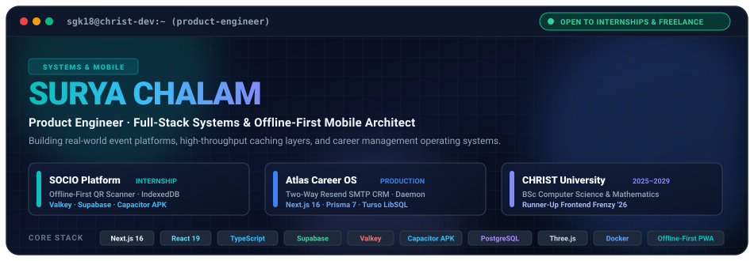
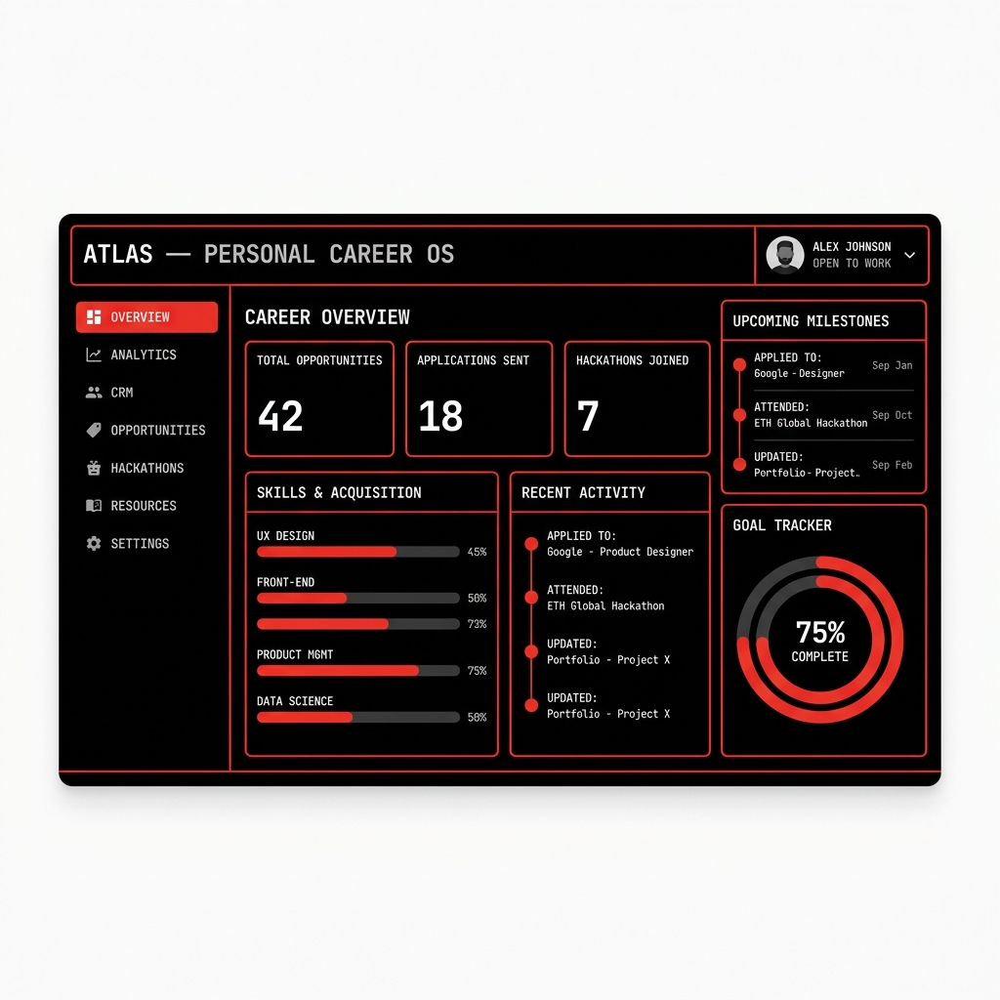

  

  
  
  
  
  
  

---

### 🌟 Flagship Systems

<table>
  <tr>
    <td width="50%" align="center" valign="top">
      
        
      <b>SOCIO · Campus Event Operating System</b>
      

        <b>Role:</b> Product Engineering Intern · CICF, CHRIST University 
        <b>Architecture:</b> Hybrid Web app, PWA, and native Android APK (Capacitor). Zero-connectivity QR attendance verification, OneSignal/FCM push dispatch, and Valkey session caching.
      

      

        
        
      

    </td>
    <td width="50%" align="center" valign="top">
      
        
      <b>Atlas · Career OS &amp; Recruiter CRM</b>
      

        <b>Role:</b> Creator &amp; Systems Architect 
        <b>Architecture:</b> Full-stack platform featuring two-way Resend SMTP threading (<code>In-Reply-To</code> resolution), 0-cookie SHA-256 telemetry analytics, and a proactive 43-window deadline audit daemon.
      

      

        
        
      

    </td>
  </tr>
</table>

#### 🚀 Selected Work

| Project | Description | Stack | Links |
| :--- | :--- | :--- | :--- |
| **Studio TFA** | Creative studio e-commerce — adaptive layouts, dynamic catalog &amp; Razorpay checkout | `Next.js` `TypeScript` `Supabase` `Razorpay` | [Repository](https://github.com/sgk18/Studio-TFA) |
| **Stockox** | AI investment intelligence — autonomous 4-agent committee (Research, Tech, News, Risk) | `Next.js` `Go/Gin` `LangGraph` `CrewAI` `Supabase` | [Live Demo](https://stockox.vercel.app) |
| **FacultyApp** | Institutional academic workflow — role-based access &amp; departmental data management | `Next.js` `Flutter` `Supabase` `PostgreSQL` | [Repository](https://github.com/sgk18/Facultyapp) |
| **NoteNova** | High-throughput academic resource platform — REST APIs &amp; PostgreSQL clustering | `Node.js` `Express` `PostgreSQL` | [Repository](https://github.com/sgk18/NoteNova_Backend) |

---

### 🛠️ Technical Arsenal

  <b>Languages:</b> 
  
  
  
  
  
  
  
  

  <b>Frontend &amp; Mobile:</b> 
  
  
  
  
  
  
  

  <b>Backend, Caching &amp; Infrastructure:</b> 
  
  
  
  
  
  
  
  

  <b>Databases &amp; ORM:</b> 
  
  
  
  
  
  
  

  <b>AI, Tooling &amp; Protocols:</b> 
  
  
  
  
  
  

---

### 📊 GitHub Activity &amp; Analytics

  

 

  
  

  <picture>
    <source media="(prefers-color-scheme: dark)" srcset="https://raw.githubusercontent.com/sgk18/sgk18/output/github-snake-dark.svg"/>
    
  </picture>

---

### 🎓 Background, Awards &amp; Credentials

| Category | Details | Period / Issuer |
| :--- | :--- | :--- |
| **Education** | **BSc Computer Science &amp; Mathematics** · CHRIST University, Bengaluru | 2025 – 2029 |
| **Experience** | **Web Developer** · Centre for Peace Praxis, CHRIST University | Jul 2025 – Present |
| **Accreditation** | **Oracle Data Platform 2025 Foundations Associate** (1Z0-1195-25) | Oracle University |
| **Accreditation** | **SQL &amp; Python Certified** | HackerRank |
| **Recognition** | **Runner-Up** · Frontend Frenzy, Xactitude IT Fest | 2026 |
| **Recognition** | **1st Place** · Mathematics Premier League, SEQUENCE | 2026 |
| **Recognition** | **3rd Prize** · National Science Exhibition, CHRIST University | 2026 |

<b>💡 View Engineering Philosophy &amp; Leadership (Click to Expand)</b>

 

#### 🧭 Engineering Principles
1. **Build for the next engineer:** Code is read far more than written. Abstractions should communicate intent clearly.
2. **Measure before optimizing:** Instrument and locate actual bottlenecks; avoid premature caching.
3. **Push complexity to the edges:** Simple architectures with clear boundaries prevent cascading bugs.
4. **Security in depth:** Defense-in-depth across database RLS, API token scoping, and input validation.
5. **Ship working software:** Deliver incrementally with scalable architecture.

#### 🤝 Leadership &amp; Community
* **Workshop Facilitator:** *"Build Your Professional Identity from Day 1"* — Junior Orientation, CHRIST University (Jun 2026)
* **Industry Delegate Host:** Industry-Academia Conclave '26, School of Sciences, CHRIST University
* **Moderator:** inbloom eSports — Science and Technology (Chess.com tournament, 2025)
* **Volunteer:** INTERFACE 2025, Department of Computer Science, CHRIST University

---

  <h3>🤝 Let's Collaborate</h3>
  
Available for <b>Product Engineering Internships</b>, <b>Distributed Systems</b>, and <b>Freelance Full-Stack Projects</b>.

  
  

    
    &nbsp;
    
    &nbsp;
    
    &nbsp;
    
  

  

    &nbsp;
    &nbsp;
    &nbsp;
    &nbsp;
    
  

  <b>Suryachalam V M</b> · BSc Computer Science &amp; Mathematics · CHRIST University, Bengaluru 
  Direct: <b>+91 9844588551</b> · <b>suryachalam18@gmail.com</b>

